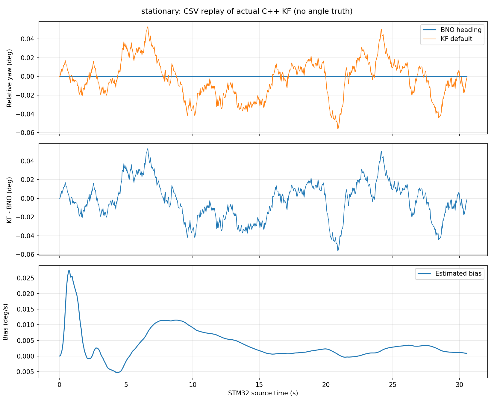
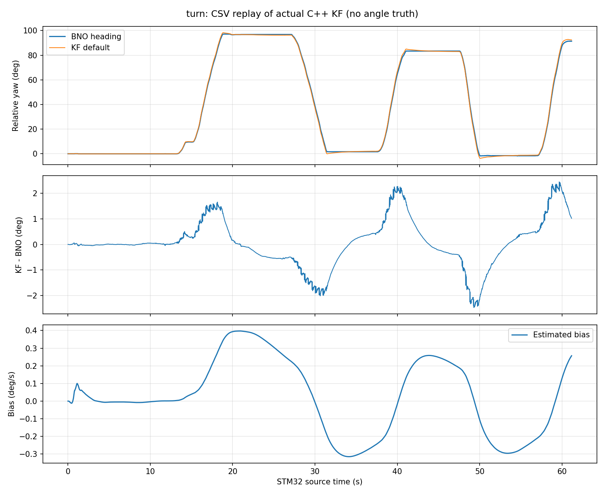
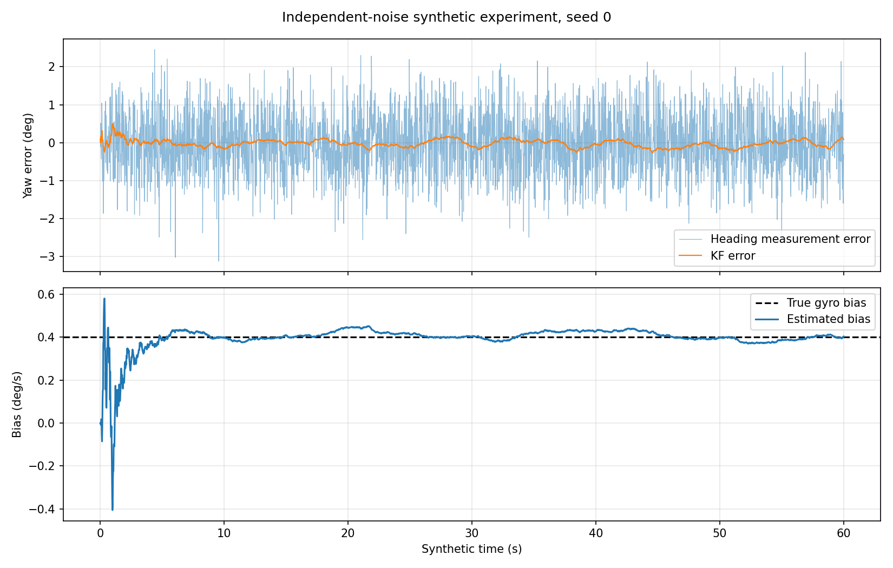

# Đánh giá Kalman offline — 15/11/2026

**Kết luận: bộ lọc C++ hoạt động trong thử nghiệm, nhưng các log thực hiện có
chưa chứng minh việc lọc thêm cải thiện yaw của BNO055 NDOF. Chưa đổi cấu hình
firmware, odometry hoặc NMPC và chưa chọn tham số để triển khai.**

## Dữ liệu và cách chạy

- `imu_boot_01.csv`: 765 mẫu đứng yên, 30,558 giây theo STM32. Tất cả mẫu đã
  được receiver chấp nhận; SYS_STATUS=5 và SYS_ERR=0.
- `turn_90_02.csv`: 3059 mẫu xoay bằng tay, 61,159 giây theo STM32. Không có
  góc chuẩn độc lập; CSV cũ không ghi trạng thái/lỗi fusion.
- `pipeline_02.csv`: 2295 mẫu đều SYS_ERR=9; chỉ kiểm tra chất lượng, loại khỏi
  khảo sát tham số. Không dùng kết quả của log lỗi để đề xuất cấu hình lọc.

Đọc các cột yaw, gyro Z và timestamp IMU của các dòng `accepted=1`. Không dựng
lại gói TEL giả, không khẳng định đã kiểm tra CRC từ CSV. Các file
`stationary_input.csv` và `turn_input.csv` giữ đầu vào chuẩn hóa để tái lập;
nguồn và SHA256 file gốc nằm trong [input_manifest.json](input_manifest.json).

`replay.cpp` gọi trực tiếp `deployment_cpp14/src/yaw_kalman.cpp` của dự án,
không viết lại thuật toán trong Python. Giữ nguyên dấu trong CSV đã dùng
`--gyro-sign 1`, timestamp nguồn và các thông số khởi tạo của bộ lọc. Không
hiệu chỉnh tỷ lệ clock khoảng 1,02 đã quan sát trước đây. Thử 11 cấu hình;
heading sigma tính bằng độ, gyro sigma bằng độ/giây và bias random walk bằng
độ/giây/căn(giây). Cấu hình mặc định: **1 / 0,35 / 0,01**.

## 1. Xe đứng yên: không thấy lợi ích lọc thêm

Bỏ 5 giây đầu, kết quả mặc định:

| Chỉ tiêu | Giá trị |
|---|---:|
| Độ lệch chuẩn yaw BNO trong CSV | 0° |
| Độ lệch chuẩn yaw Kalman | 0,02192° |
| Biên độ đỉnh–đỉnh yaw Kalman | 0,10928° |
| Độ lệch chuẩn gyro Z | 0,10169°/s |
| Bias ước lượng cuối lần đo | 0,000879°/s |

Yaw BNO giữ nguyên trong độ phân giải dữ liệu đã ghi; điều này không chứng
minh góc thật hoàn toàn chính xác hoặc không có chuyển động dưới độ phân giải.
Bộ lọc bổ sung đưa nhiễu gyro vào bước dự đoán và tạo một dao động nhỏ mà đầu
vào heading không có. Đây không phải kết quả cải thiện trong lần ghi này.



## 2. Xoay tay: bias đổi theo chuyển động

Sau 5 giây đầu, RMS chênh lệch yaw Kalman so với heading BNO khoảng **0,968°**.
Đây là độ khác nhau giữa hai tín hiệu, không phải sai số so với góc thật.
Bias ước lượng chuyển từ dương sang âm theo chiều quay, đạt độ lớn khoảng
**0,397°/s**. Điều này gợi ý bộ lọc đang dùng biến bias để hấp thụ sự không
nhất quán giữa tích phân gyro và heading; chưa thể coi đó là bias vật lý đã
được đo đúng. Clock nguồn, fusion nội bộ, trục lắp và chuyển động nghiêng đều
có thể ảnh hưởng, chưa xác định nguyên nhân duy nhất.

Ví dụ các đoạn giữ yên đã chọn trong báo cáo xoay trước:

| Khoảng thời gian STM32 | Std yaw BNO | Std yaw Kalman |
|---|---:|---:|
| 2–10 s | xấp xỉ 0° | 0,0236° |
| 21–26 s | xấp xỉ 0° | 0,1765° |
| 42–46 s | 0° | 0,3301° |
| 52–56 s | 0,0371° | 0,2626° |

Các đoạn có thể chứa quá trình bộ lọc hồi phục sau xoay; không coi toàn bộ
biến thiên là nhiễu ngẫu nhiên. Chưa thể đo độ trễ vật lý hoặc độ chính xác
90° từ thao tác căn tay và các tín hiệu có chung nguồn cảm biến.



## 3. Dữ liệu tổng hợp có góc thật: kiểm tra khả năng thuật toán

Thử 10 seed, 60 giây/seed, 50 Hz, bias thật 0,4°/s, nhiễu heading Gaussian
sigma 0,8° và gyro sigma 0,35°/s độc lập. Đo sau 20 giây đầu:

| Chỉ tiêu trung bình 10 seed | Giá trị |
|---|---:|
| RMSE heading đo so với góc thật | 0,8046° |
| RMSE yaw Kalman mặc định so với góc thật | 0,1068° |
| Bias cuối các seed | 0,3772–0,4202°/s |

Đây là kết quả tốt dưới giả thiết tổng hợp. Không suy ra mức cải thiện tương
ứng trên BNO055: heading NDOF đã dùng gyro nội bộ, nên hai đầu vào tương quan,
trong khi bộ lọc bổ sung chưa mô hình hóa tương quan này.



## 4. Khảo sát tham số và bước tiếp theo

Xem đủ 11 cấu hình trong [sensitivity.csv](sensitivity.csv) và
[metrics.json](metrics.json). Ví dụ giảm heading sigma từ 1° xuống 0,25°,
giữ hai tham số còn lại, làm RMS chênh lệch với BNO giảm từ 0,968° xuống
0,359°. Đó chủ yếu là tăng độ tin vào BNO; chưa chứng minh giảm sai số thật.
Tăng bias random walk lên 0,1 cũng giảm chênh lệch nhưng làm bias cuối lên
khoảng 0,968°/s: sự khớp tín hiệu có thể che việc bias đang bù sai lệch khác.

Giữ bộ lọc ở chế độ chẩn đoán, chưa đưa yaw/bias này vào điều khiển. Khi có
phần cứng, ghi log mới sau thay đổi reset NDOF, kiểm tra 5/0, giữ xe ngang,
xoay cả hai chiều ở ít nhất hai tốc độ và dùng dấu góc độc lập. So sánh cả
sai số, độ trễ và bias theo chuyển động, thay vì chọn đường mượt nhất.

## Tái lập và file kết quả

Cần Python với numpy/matplotlib và g++ hỗ trợ C++14. Chạy từ repo:

```sh
MPLCONFIGDIR=/tmp/kalman-mpl XDG_CACHE_HOME=/tmp/kalman-cache \
  python3 docs/sensor_reports/kalman_offline_20261115/analyze.py
```

Đây là script phân tích thử nghiệm, không phải tính năng runtime mới. C++ KF
đã qua kiểm thử hội tụ bias, wrap góc, thiếu heading và covariance. Kiểm tra
artifact xác nhận đủ mẫu, 11 cấu hình và tất cả đầu ra hữu hạn. Chưa có kiểm
chứng phần cứng cho báo cáo này.

- [Toàn bộ kết quả ZIP](kalman_offline_results.zip)
- [CSV đứng yên trước/sau lọc](stationary_default_output.csv)
- [CSV xoay trước/sau lọc](turn_default_output.csv)
