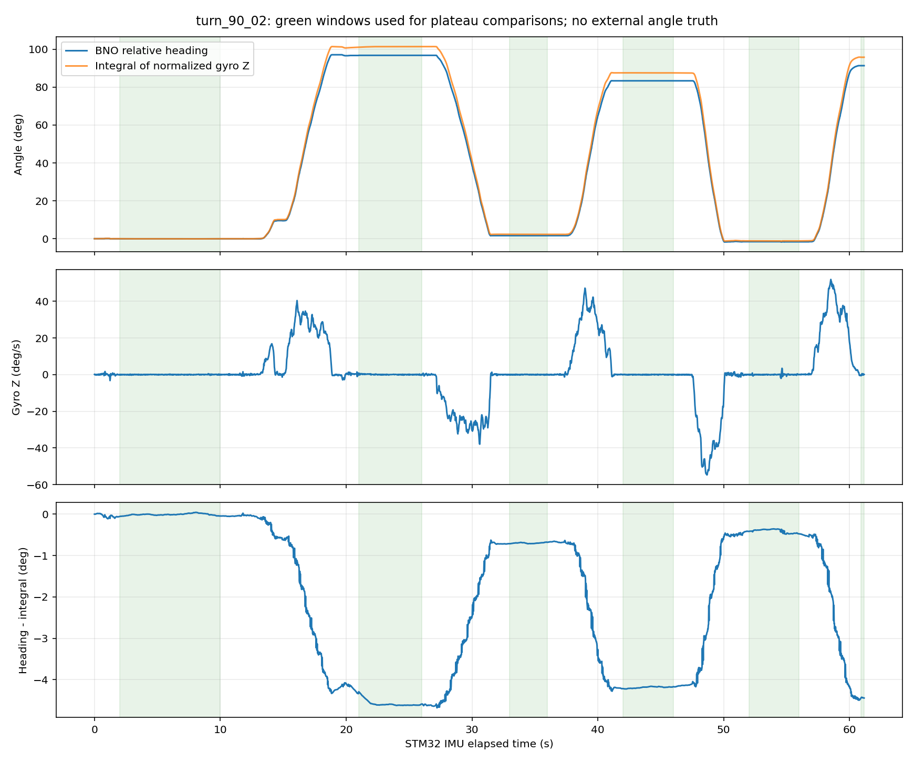

# Kết quả phân tích turn_90_02

[Mở hình phân tích](diagnostics.png) · [So sánh góc](turn_angles.png) · [Bảng CSV](turn_comparison.csv) · [Tải gói ZIP](turn_90_02_results.zip)

## Tính liên tục

3.059 mẫu, tất cả accepted; số thứ tự gói liên tục, chu kỳ gửi 20 ms.
Thời gian theo STM32 là 61,159 giây; tuổi mẫu IMU 6–9 ms và độ lệch thời gian hai cảm biến tối đa 8 ms.
Encoder giữ nguyên 0, nên chưa đánh giá chuyển động X/Y.

## Các lượt quay

Góc được tính bằng chênh lệch giữa các đoạn giữ yên, không dùng 90° làm góc thật khi chưa có xác nhận đo độc lập.

| Lượt | Đổi heading | Tích phân gyro | Gyro / heading |
|---|---:|---:|---:|
| 1 | +96,87° | +101,47° | 1,0474 |
| 2 | −95,18° | −99,09° | 1,0411 |
| 3 | +81,74° | +85,22° | 1,0426 |
| 4 | −84,93° | −88,73° | 1,0447 |
| 5 | +92,93° | +96,98° | 1,0436 |

Lượt cuối chỉ có khoảng 0,44 giây heading giữ nguyên trước khi kết thúc, nên kết quả còn sơ bộ.
Dấu dương/âm là quy ước trong dữ liệu; cần đối chiếu thao tác trái/phải thực tế.



## Nhận xét và giới hạn

- Tích phân gyro lớn hơn độ đổi heading khoảng 4,1–4,7% ở cả hai chiều. Chưa áp dụng bất kỳ hệ số hiệu chuẩn nào.
- Tương quan tốc độ heading với gyro trung bình trên cửa sổ 200 ms ở các đoạn chuyển động khoảng +0,99957.
- Đoạn gần tĩnh từ giây 2 đến 10: gyro trung bình −0,00156°/s, độ lệch chuẩn 0,10582°/s. Không coi đây là bằng chứng nhiễu độc lập/Gaussian.
- Calibration toàn log là hex 34: system 0, gyro 3, accelerometer 1, magnetometer 0. Chưa có cơ sở coi heading tuyệt đối là chuẩn.
- Chưa có góc tham chiếu độc lập, roll/pitch, file TEL gốc hay timestamp máy chủ. Không thể kết luận gyro sai hệ số hoặc đo độ trễ/thang thời gian chính xác từ CSV này.
- CSV không chứa bộ đếm lỗi I²C/recovery hoặc các khung CRC bị loại.

Bước tiếp theo: xác nhận có căn dấu/thước 90° hay quay bằng tay; giữ xe phẳng, giữ yên ít nhất 5 giây ở mỗi mốc và lưu cả TEL .log gốc.

## Chạy lại

Cần Python với numpy, pandas và matplotlib. Đặt CSV gốc trên máy của bạn rồi chạy:

```bash
python3 analyze.py /duong/dan/turn_90_02.csv
```

Các kết quả sẽ được ghi vào thư mục chứa script. File ZIP chứa bản sao báo cáo, hình, số liệu và script; không chứa CSV gốc.
