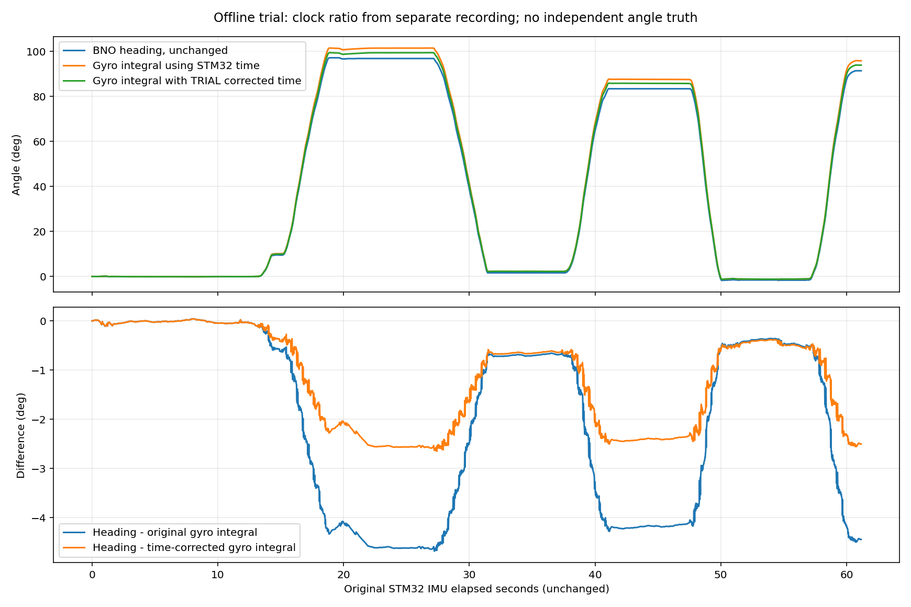

# Thử hiệu chỉnh thang thời gian — turn_90_02

Đây là thử nghiệm ngoại tuyến. Dữ liệu gốc, clock firmware và biên độ gyro được giữ nguyên.

Tỷ lệ do người dùng đo trong clock_trial_01:

- Pi: 119,971948825 giây; STM32: 122,44 giây.
- Hệ số fit nguồn/Pi: **1,020673210227752**.
- Thử dùng dt_trial = dt_STM32 / 1,020673210227752, tương đương nhân **0,979745515**.
- Tỷ lệ được lấy từ lượt đo khác, chưa có clock_trial_02 để xác nhận độ lặp lại.

## Kết quả tính lại

Mốc đầu/cuối lấy ở giữa các đoạn giữ yên, nội suy tín hiệu tại mốc. Vì cách này dùng mốc cụ thể thay vì median của tích phân trong cả cửa sổ như báo cáo đầu, số tích phân gốc có thể khác vài phần trăm độ.

| Lượt | Heading | Gyro, thời gian gốc | Gyro, thời gian hiệu chỉnh thử | Chênh lệch tương đối sau sửa so với heading |
|---|---:|---:|---:|---:|
| 1 | +96.87° | +101.44° | +99.39° | 2.60% |
| 2 | -95.18° | -99.06° | -97.05° | 1.97% |
| 3 | +81.74° | +85.20° | +83.47° | 2.12% |
| 4 | -84.93° | -88.74° | -86.95° | 2.37% |
| 5 | +92.93° | +97.01° | +95.04° | 2.27% |

Đây là chênh lệch giữa hai tín hiệu, không phải sai số so với góc thật. Người dùng xác nhận căn góc bằng tay nên tất cả reference_deg vẫn để null. Lượt cuối có đoạn giữ góc ngắn.



## Kết luận có thể rút ra

Hiệu chỉnh thời gian theo tỷ lệ vừa đo giảm chênh lệch gyro–heading từ khoảng4,1–4,7% xuống khoảng2,0–2,6%. Điều này phù hợp với giả thuyết thang thời gian góp phần đáng kể vào sai khác. Nó không chứng minh phần còn lại là sai hệ số gyro hay heading đúng; cũng chưa xác minh ratio này ổn định giữa các lần khởi động/nhiệt độ.

Không ép bias Kalman hoặc hệ số gyro để bù phần còn lại. Chưa sửa TIM4, HSI, thời gian PID hay NMPC. BNO vẫn chưa hiệu chuẩn đầy đủ (hex34 trong log góc), chưa có nguồn góc ngoài.

## Chạy lại

Windows JSON dùng **giây STM32 gốc**, không phải giây đã hiệu chỉnh:

```bash
python3 deployment_cpp14/tools/audit_turns.py turn_90_02.csv \
  --windows docs/sensor_reports/turn_90_02/time_trial_windows.json \
  --gyro-multiplier 1 --source-clock-ratio 1.020673210227752 \
  --output turn_90_02_time_trial.json
```

Công cụ giữ gyro_integral_deg gốc và thêm gyro_time_corrected_integral_deg, time_corrected_duration_s. Nếu cung cấp bias-dps, bias được trừ theo thời gian đã hiệu chỉnh. Mặc định source-clock-ratio=1 giữ nguyên phép tính cũ.

Bước phần cứng kế tiếp: lặp bài đo clock120s với tên clock_trial_02 để xác nhận tỷ lệ. Sau đó dùng dấu/thước góc độc lập trên mặt phẳng cho lượtquay ±90°. Chỉ chốt hiệu chuẩn khi có cả bằng chứng thời gian và góc tham chiếu.
